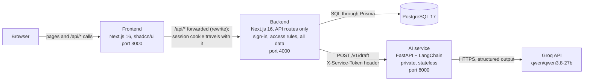
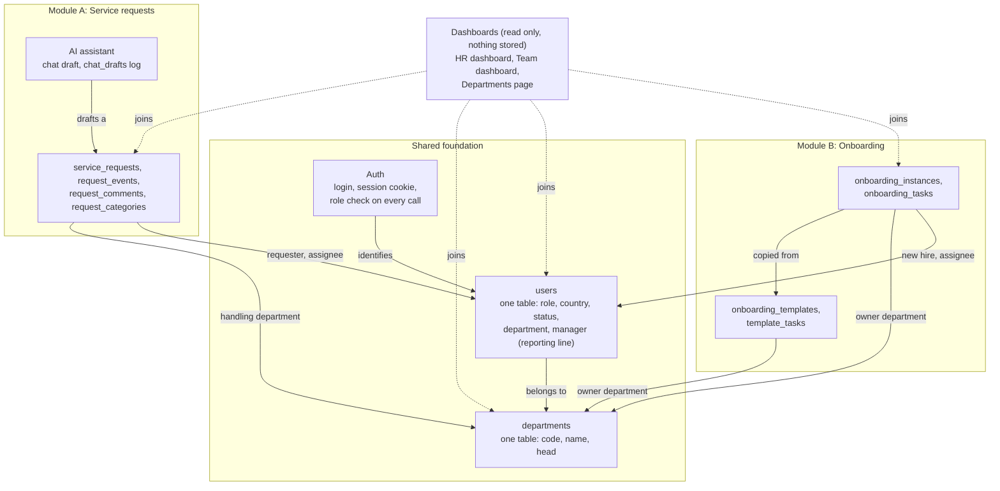
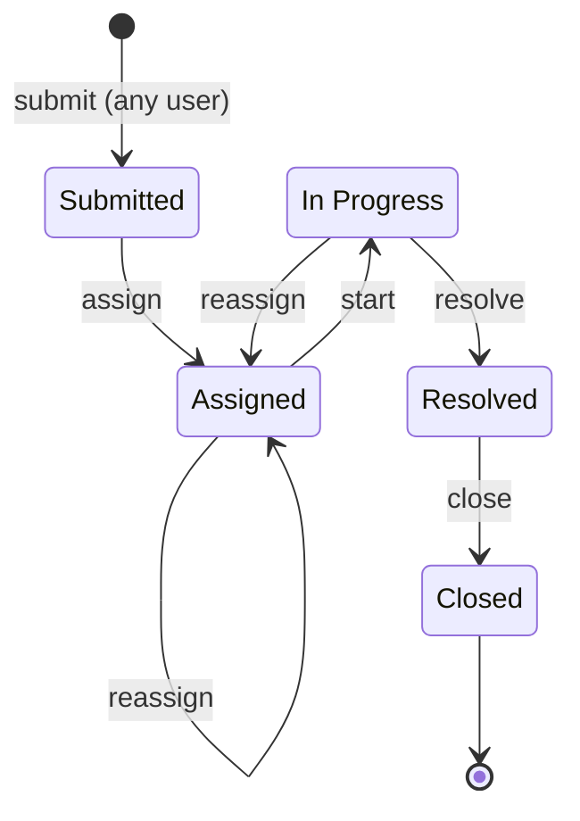
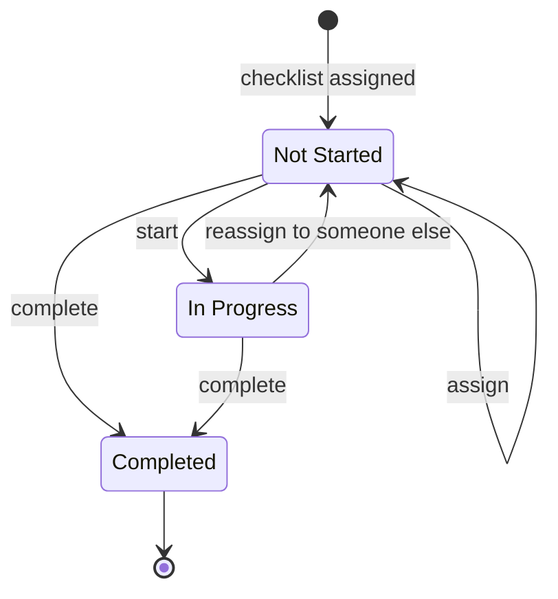
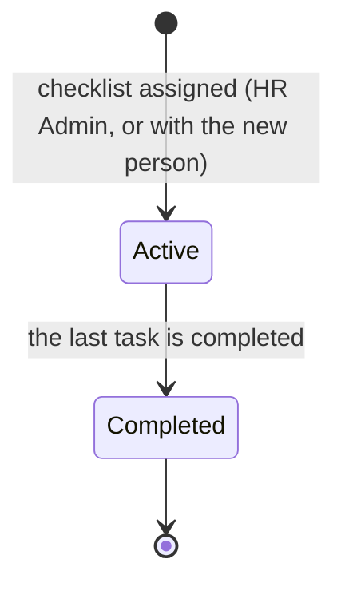
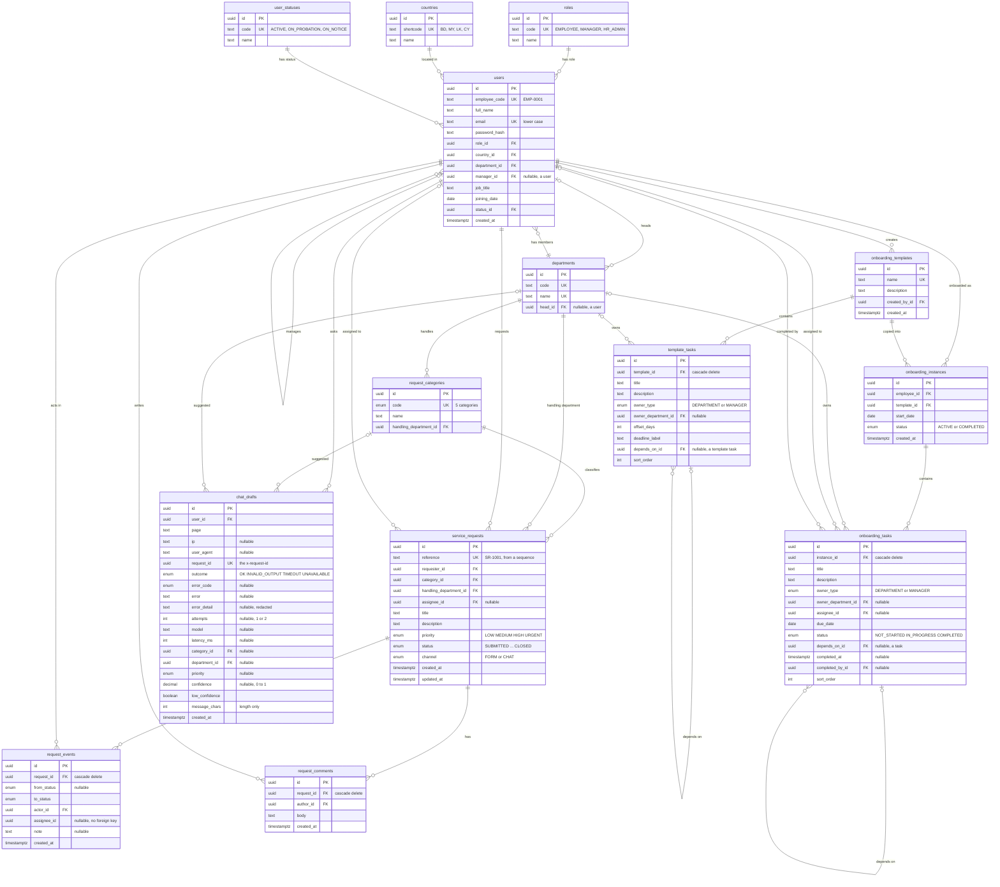

# ARCHITECTURE

---

# Part 1: Architectural decisions (author's notes)

## Feature based decisions.

### Module A : Service Request

1. An person in the company can create a service request. A service request involves title, description, urgency, Department that the request is to be routed. HR Admin can see all request and status and deparment managers can see reqeusts that are routed to their department. An HR admin and manager can assign a team member in the department. Members can be reassigned. After completion of task. That can be closed by the person who opened it. users may add notes and comments in the request flow.

2. Currently, A resolved request stays open untill the person who opened it closes. In next phase , it may be decided after how long the request automatically gets closed if not interacted with it or HR Admin / manager can close it  y their role scope. No notifications currently is not served. in future, state updates may be routed to user notification box and completion of request may also be informed through in app and email. Sometimes a request may need to be re routed through different department. My assumption is that a manager for the department assigns to HR Admin and HR Admin forwards it. Attachment Facility should be used if any conviennce fee is required by employee. these are proposed but not built.

3. Service request can be filtered by their status.
### Module B Onboarding.

1. Onboarding system includes a new employee, a task checklist for that employee. Which department the employee is going to be assigned to. Therefore there are two systems that has to be implemented. One where the system allows the creation of a new employee. another where the system permits creating a templated checklist for onboarding. The system allows the creation of employee without checklist because a template may not exist yet for that postition and later, An HR admin can create the checklist and assign it to that employee. this enables onboarding a new user without mandadory checklist - for loose coupling so that creating of new employee does not get hung up on template. Also, an employee may start working on a specific day but on boarding may get late due to unforseen reasons, therefore, their employment date is preserved.

2. An HR Admin can create a template checklist for different role. Each task in the checklist has the option to assign a department for that task. When a checklist is assigned, the respective department manager can see that in their task queue and can assign anyone in the department for that task, Here HR Admin can also assign and reassign for a particular task in the checklist.

3. After successful onboarding completion, the employee gets in the department that he was assigned to.

4. When creating employee, an employee role maybe same (set of permissions, setup etc.) but they may hold different job title, therefore, HR admin can assign role and Job title seprately. In the future this may become role with Job title, for example, role :employee , title : Software Engineer, Role : employee , Title HRIS System Developer. password creation is not kept default for easy user creation, in future, new onboarding employees will get a link to create / update password to activate their account only after HR Admin has created.

5. Tasklist is designed to be asynchronous process, one task may or may not depend on other task so that non dependent work can be done smoothly.

Roles and access scopes are maintained with jwt tokens.

Please note Task Queue tab shows on boarding related tasks that are assigned to the department for completion. Manager can assign task from there.

## AI Feature : (Intelligent Request Router)

For the intelligent request router, a user types their request description in plain language. that request is routed to AI Service. Using LLM with department, System context and user request, the AI Service returns a strucutured output to the backend web app. A user can review and edit if needed and submit it. here , I am usign the need for human in the loop for ensuring consistency. Currently using GROQ API. For unrelated or ambioguous requests, the response tells the user explicitly to verify the response.

## Dashboard :

Separate Dashboard for HR Admin and Manager. HR Admin can see overall progress of service requests and status of on boarding, while a Manager can only see their own department progress. Admin dashboard is verified. Manager dashboard needs verification of dashboard data.

## Auth and RBAC :
Roles are currently checked with wrapper. Each wrapper gets the employee ID from jwt token to fetch permission. The role is not embedded in the jwt because if permission is revoked, then it would reflect instantly. Authentication is now based on email and password.

Extra features i added to see departments, and employees associated with them to easily debug the workflow and user that can be assigned for a task.

## System architecture Design Decision:

1. I decided on a 3 Service system - Web application Frontend, web application backend, both on nextjs and ai-service on FastAPI. The reason for this is that then the system remains loosely coupled and its easier to update and maintain features and also can be easily collaborated with others. The frontend connects with backend. The backend then connects with the AI Service. As Future AI feature maybe added, ai feature based development on python is much omore easier for future development maintainability. currently the web app is communicates with ai service with api but as system grows and long running task may arrive, we may have to move to asychronous processing strucuture.

## Database design

Database contains various tables. The thing i gave emphasis while building is maintainablity. For example, using role directly for a user may arise issue in updateing role info in the fututre beacause many records will need to be updated. on the other hand using a foreign key for roles and dedicated role table ensures easy and consistency. similar goes for country, employee status.

## API Design

API are designed with versioning. currently its on v1 version. Currently wrappers are used for authorization. in next iteration, it should be moved to middleware.

---

# Part 2: The system as it is today

## 2.1 Overview and architecture diagram

An internal HR platform for a company of about 100 people in Bangladesh, Malaysia, Sri Lanka and Cyprus. It has two modules on one shared base of users, departments, roles, countries and statuses: **service requests** and **employee onboarding**. An AI chat assistant helps fill in a service request. There are three roles: **Employee**, **Manager** and **HR Admin**.

- The browser only talks to the frontend. The frontend forwards `/api/*` to the backend (`frontend/next.config.ts`), so the session cookie is first-party and no CORS setup is needed.
- Only the backend reads or writes the database. The frontend has no database access and no secrets.
- Only the backend calls the AI service, with a shared token. The AI service has no database and keeps no state; only it talks to Groq and only it holds the Groq key.
- The AI call is one synchronous HTTP request and response (the backend waits up to 25 seconds).

| Service | Folder | Technology | Responsibility |
|---|---|---|---|
| Frontend | `frontend/` | Next.js 16 (App Router), TypeScript, shadcn/ui on Base UI, Tailwind, TanStack Query, ApexCharts | The UI. Hides what a role cannot use; makes no access decisions. |
| Backend | `backend/` | Next.js 16 with Route Handlers only, TypeScript, Prisma 7, zod, `jose`, `bcryptjs` | Authentication, access control, all reads and writes, state rules, dashboards, schema, migrations, seed, logging. |
| AI service | `ai-service/` | Python, FastAPI, LangChain, Groq | Turns one chat message into a draft service request. |
| Database | | PostgreSQL 17 | The only store of data. |

No code is shared between the services; the contract is the HTTP API (§2.10 and the AI service's own `/v1/draft`).

**Running it.** `docker compose up --build` starts all four parts (database, backend, AI service, frontend). On start the backend applies the migrations and adds the demo data only if the database has no people (`backend/prisma/seed-if-empty.ts`), so a restart never wipes data. Each service has a `Dockerfile`. Only the frontend (port 3000) and the database (port 5433) are published to the host.

**Not verified:** deployment. The project is designed for Vercel (two projects) and a hosted PostgreSQL, but this repository has only been run locally.

## 2.2 How the modules relate to the shared parts

**How the two modules share data without duplication**

- **One `users` table.** A requester, a request assignee, a new hire, a task assignee, a template author and a Manager are all rows of the same table. Neither module has its own copy of a person.
- **One `departments` table.** A department is the *handling department* of a request and the *owner department* of an onboarding task, and its `head_id` says who triages for it. The same head assigns both requests and tasks.
- **One reporting line** (`users.manager_id`). It decides which requests and checklists a Manager sees, which new hire a `MANAGER` task goes to, and who is in a Manager's Team dashboard.
- **Lookups are shared too.** Role, country and status are rows of `roles`, `countries` and `user_statuses`, referenced by both modules through `users`.
- **Dashboards join; they do not copy.** The HR and Team dashboards run queries over `service_requests`, `onboarding_tasks`, `onboarding_instances` and `users` each time they are asked. Nothing is stored or counted ahead of time, so nothing can drift. One cross-module figure, "new hires with open requests", joins an active checklist to the same person's open requests.
- **Auth is the gate for both.** Every route in both modules goes through the same `withAuth` wrapper and the same row-scoping functions (§2.3).

## 2.3 Access control (RBAC)

Four layers, all in the backend. The frontend only hides what a role cannot use.

1. **Identity.** Login with email and password (`bcryptjs`) sets an HTTP-only `hris_session` cookie holding a signed JWT (HS256, 8 hours). The token carries **only the user id**. On every request `getAuthUser` (`backend/src/lib/auth.ts`) loads the user, role and status from the database, so a role change applies at once. This is the decision in Part 1.
2. **Route gate.** Every route handler is wrapped in `withAuth(handler, { roles })` (`backend/src/lib/with-auth.ts`), built on `withRequest`. It answers `401` with no valid session and `403` for a role not in the list (401 is checked first), and writes `auth.session_invalid` and `auth.forbidden` events to the log.
3. **Row scoping** (`backend/src/services/policy.ts`). Functions such as `scopeRequests`, `scopeUsers`, `scopeInstances` and `scopeOwnedTasks` return Prisma `where` clauses that queries must use. A row outside the caller's scope answers `404`.
4. **Action rules** (`backend/src/services/state-machine.ts`). Pure functions decide whether this actor may do this action on a record in its current state (`409` or `403` otherwise). The same functions produce `allowedActions`, which the UI uses to show buttons.

**Middleware.** The backend has no Next.js middleware; the wrappers above do that job. The only middleware-style file is `frontend/proxy.ts`, which redirects to `/login` when the session cookie is missing. It does not validate the session. Moving authorisation into middleware is a stated next step (Part 1). Nothing forces a new route to use `withAuth`.

**Roles.** There are three, stored as rows of the `roles` table (`EMPLOYEE`, `MANAGER`, `HR_ADMIN`); a user points to one by foreign key. There is no fourth role. A Manager heads their own department (`departments.head_id`, one Manager per department), and the scoping and action rules read that.

**How "a Manager approves or assigns requests for their team" is read.** The brief's sentence is read as follows, and this is what the code does:

- **Assignment belongs to the head of the handling department, not to the requester's manager.** A Manager can assign a request only if it is routed to the department they head (`request.handlingDepartmentId = manager.headOfDepartmentId`). HR Admin can assign any request.
- **There is no separate approval step.** A request is `Submitted` until someone assigns it; "approve and assign" is the single assign action.
- **A Manager can see the requests of their direct reports** (`scopeRequests` includes `requester.managerId = me`), **but cannot assign them** unless they also head the department it is routed to. For example, an Engineering Manager sees an Engineering employee's IT request, but only the Head of IT Operations (or HR Admin) assigns it.

| Capability | Employee | Manager | HR Admin |
|---|---|---|---|
| Submit a request | yes | yes | yes |
| See requests | own and assigned to them | also direct reports' and the queue of the department they head | all |
| Assign or reassign a request | no | requests routed to the department they head | any |
| Start or resolve a request | if assignee | if assignee | if assignee |
| Close a request | if requester | if requester | yes |
| Comment on a request | on any they can see | on any they can see | on any |
| See onboarding checklists | own | own, direct reports', and any with a task owned by their department | all |
| Assign an onboarding task | no | tasks owned by the department they head | any department task |
| Start or complete a task | if assigned | if assigned, or it is their department's, or their own `MANAGER` task | only tasks assigned to them |
| Templates, create people, assign checklists | no | no | yes |
| HR dashboard (`/dashboard`) | no | no | yes |
| Team dashboard (`/team`) | no | own direct reports | no |
| People list | no | direct reports | everyone |

## 2.4 Module A: service requests

- Anyone can submit a request with a title, description, priority (Low, Medium, High, Urgent) and a category. The category decides the handling department (IT Equipment and Software Access go to IT Operations, HR Query and Other to People & Culture, Facilities to Operations); the form can also name a different department. The request gets a reference such as `SR-1001`.
- The Manager of the handling department, or an HR Admin, assigns it to an active member of that department, and can **reassign** it later.
- Every change writes a history row (`request_events`). Users with access to a request can add comments (`request_comments`).
- The request list filters by status, and also by category, priority, country, channel and "mine".
- Requests carry a channel: `FORM` (the normal form) or `CHAT` (raised through the AI assistant).

**Not built:** forwarding a request to another department (the Part 1 idea of the manager passing it to HR Admin), attachments, notifications (in-app or email), automatic closing, and reopen, withdraw or reject.

### 2.4.1 State machine: service request

| From | Action | To | Who may do it | Rule |
|---|---|---|---|---|
| none | `submit` | Submitted | Any signed-in user | Routed to the category's handling department (or the one chosen on the form) |
| Submitted, Assigned, In Progress | `assign` (also reassign) | Assigned | Head of the handling department; HR Admin | The assignee must be an active (Active or On probation) member of the handling department. Reassigning an **In Progress** request sends it back to **Assigned**, so the new assignee starts it. It must go to someone other than the current assignee |
| Assigned | `start` | In Progress | The assignee only | HR Admin has no override |
| In Progress | `resolve` | Resolved | The assignee only | Optional note |
| Resolved | `close` | Closed | The requester, or HR Admin | Final state. A Manager can close only their own requests |

- Any other combination answers `409` (wrong state) or `403` (not permitted).
- A database check keeps the data honest: a request that is not `Submitted` must have an assignee.
- Each change and its history row are written in one transaction, and the update only applies if the request is still as it was read (a second click or another person's change gets `409`).

## 2.5 Module B: onboarding

- **People and checklists are separate.** HR Admin creates a person (`POST /users`) with name, email, country, role, department, manager, job title, joining date and status. Role and job title are separate fields. A checklist is optional: it can be created with the person (`templateId`), or assigned later by HR Admin. The joining date is stored on the person, so it does not depend on when the checklist is made.
- **Passwords.** HR Admin can set the initial password; otherwise one is generated and shown once. There is no activation link or self-service reset.
- **Templates.** HR Admin creates and edits templates of tasks. Each task has an owner type (a department, or the new hire's manager), a due-day offset and at most one dependency (chains are allowed). Assigning a template copies its tasks into a checklist (due date = start date + offset), so later edits to a template do not change checklists already assigned.
- **Task queue.** A task owned by a department is first assigned to nobody. The department head sees every task the department owns and either does it or assigns it to one active member of the department; HR Admin can assign any department's tasks. The assignee then sees it in their queue; other members do not. A `MANAGER` task is assigned to the new hire's manager when the checklist is created.
- **Dependencies.** A task whose dependency is not completed is **blocked** (calculated, not stored). Tasks that do not depend on each other can be done in any order.
- **Overdue** is calculated against today's date in Asia/Dhaka.
- **Completion.** When the last task is completed, the checklist becomes `COMPLETED`. **This does not move the person.** Part 1 says the employee "gets in the department" after onboarding; in the code the department is chosen when the person is created and does not change when the checklist finishes. The person's status is also not changed by completing a checklist.

**Not built:** cancelling an onboarding, deleting or archiving templates, reopening a completed task, editing a person after creation, deactivation.

### 2.5.1 State machine: onboarding task

Blocked is not a stored state. A task is **blocked** while the task it depends on is not `Completed`, and it becomes unblocked by itself when that one is completed. In the API it shows as `blocked: true` and a display status of Blocked.

| From | Action | To | Who may do it | Rule |
|---|---|---|---|---|
| Not Started | `start` | In Progress | The task owner | Refused (`409`) while blocked |
| Not Started, In Progress | `complete` | Completed | The task owner | Refused (`409`) while blocked |
| Not Started, In Progress | `assign` (also reassign) | Not Started | Head of the owning department; HR Admin | Department tasks only (a `MANAGER` task cannot be assigned). The assignee must be an active member of the owning department and a different person from the current assignee. A blocked task **can** be assigned ahead of time. Reassigning an In Progress task sends it back to Not Started |
| Completed | none | | | Final. A completed task cannot be assigned or reopened |

**Task owner** (who may start or complete): the person the task is assigned to; for a department task also the head of the owning department (who does it directly or delegates). Other members of the department are not owners. **HR Admin has no override:** they can see every task and assign department tasks, but start or complete only tasks assigned to them. A task is blocked, in the wrong state or not yours: `409` for the first two, `403` for the third.

### 2.5.2 State machine: onboarding checklist

| From | Event | To | Who | Rule |
|---|---|---|---|---|
| none | checklist created from a template | Active | HR Admin (`POST /onboarding/instances`, or `templateId` when creating a person) | At most **one Active checklist per person** (a database index; a second one answers `409`). A template with manager tasks needs the person to have a manager |
| Active | the last unfinished task is completed | Completed | Automatic | Checked in the same transaction as the task's completion. Nothing else changes (not the person's department or status) |
| Completed | none | | | Final. There is no cancel or reopen |

## 2.6 AI request assistant

Flow: the user types a message in the chat head, the frontend calls `POST /requests/chat-draft` on the backend, the backend calls the AI service (`POST /v1/draft`), and the AI service asks the model for structured output (schema in `ai-service/app/schemas.py`).

- **What the model receives:** the message, the requester's country and department name, and the list of categories and departments. It returns a title, description, category, priority, confidence and reasoning.
- **Human in the loop.** The backend checks the draft (codes must be from the lists it sent) and returns it. Nothing is saved as a request. The user reviews and edits a request card and submits it through the normal request endpoint, with channel `CHAT`.
- **Unclear or unrelated messages.** The prompt tells the model to use the `OTHER` category and a low confidence. The backend returns `lowConfidence`, and the request card shows a notice asking the user to check it.
- **Failure.** If the AI service is down, times out or returns something invalid, the backend answers `503 AI_UNAVAILABLE` and the frontend shows a toast ("The AI service is currently unavailable. You can still fill in the form yourself."). The rest of the app works; the form never depends on the AI.
- **Records.** The backend stores one row per attempt in `chat_drafts` (outcome, timing, redacted details) for developers. The message text is not stored or logged, only its length. Tracing to third parties is forced off in the AI service.
- **Calls are synchronous**, as in Part 1. No queue or background processing exists.

**Not verified:** the assistant has been tested with the model mocked, and the AI service over HTTP against a model earlier in development. It has not been confirmed against Groq with the current default model and key. `docs/architecture-v2.md` also describes assignee recommendation and database views for the AI service; **neither is built**.

## 2.7 Dashboards

Both are computed from live tables on each request; nothing is stored. Both are covered by automated tests that compare numbers against hand calculations.

- **HR dashboard** (`GET /dashboard/summary`, HR Admin only): headcount by country, requests by status and category, new hires in progress, overdue and blocked onboarding tasks, and cross-module figures (new hires with open requests, requests waiting per department).
- **Team dashboard** (`GET /dashboard/team?days=7|30|90`, Manager only): for the Manager's **direct reports**: requests open and resolved with average time to resolve, onboarding tasks on time vs late, overdue and blocked, the team's new hires, and a per-person table. It shows no ranking or score. **It is based on direct reports, not on the department**, which differs from the Part 1 wording ("their own department"). Spec: `docs/spec-manager-dashboard.md`.
- A Manager lands on `/team` after login; an HR Admin on `/dashboard`; an Employee on `/requests`.
- Whether the dashboards look right in a browser is not confirmed in this repository's records; the numbers are verified by tests only.

## 2.8 Extra pages

- **Departments** (`/departments`, HR Admin; `GET /departments/breakdown`): departments with their people and heads. This is the helper added to see who can be assigned a task.
- **People** (`/people`): the list of people (Managers see direct reports) and the new-hire form.

## 2.9 Database

### Why PostgreSQL

- The data is relational and cross-linked: people, departments, requests and tasks refer to each other, and the dashboards join them. A relational database with foreign keys fits that directly.
- Rules are enforced in the database as well as in code: foreign keys, enums, CHECK constraints and partial unique indexes (for example, one Active checklist per person) reject bad data even if application code has a bug.
- State changes need transactions: a status change and its history row, or creating a person with their checklist, succeed or fail together.
- It generates the request reference (`SR-1001`, `SR-1002`, …) from a sequence, safely under concurrent requests.
- It is free and runs the same in Docker on a laptop as on a hosted service. The code accesses it through Prisma 7 (schema in `backend/prisma/schema.prisma`, migrations in `backend/prisma/migrations/`).

### Entity-relationship model

**Constraints beyond keys and types** (hand-written SQL in `backend/prisma/migrations/`; Prisma's schema language cannot express them):

| Table | Constraint |
|---|---|
| `users` | A person cannot be their own manager. Email must be lower case. `role_id`, `country_id` and `status_id` use `ON DELETE RESTRICT`, so a lookup row in use cannot be deleted |
| `service_requests` | A request that is not `SUBMITTED` must have an assignee. `reference` is filled by the database from a sequence |
| `template_tasks`, `onboarding_tasks` | `owner_type = DEPARTMENT` if and only if `owner_department_id` is set. A task cannot depend on itself. Template `offset_days` is at least 0 |
| `onboarding_instances` | A partial unique index: one `ACTIVE` checklist per employee |
| `onboarding_tasks` | Partial indexes for the department queue and the assignee queue (unfinished tasks only) |
| `service_requests` | A partial index for the department queue |
| `chat_drafts` | `error_code` is set if and only if `outcome` is not `OK`. Confidence is between 0 and 1. Attempts is 1 or 2. `error_detail` is at most 4000 characters. `request_id` is unique |
| All tables | Row-level security is switched on with no policies, so only the table owner (the backend's connection) can read or write |

**Roles and other lookups.** A user's role, country and status are not text on the user. They are rows of `roles`, `countries` and `user_statuses`, and `users` holds a foreign key to each. Renaming a role or a country is one row update instead of many, and a value that is not in the table cannot be stored. Behaviour compares the stable `code` (or `shortcode`), never the generated id. The API returns these as objects with an id and filters by id; `GET /meta` lists the ids. They change by migration, not through the API. Request categories are a table too, and each points to the department that handles it.

**`chat_drafts`** is a developer log of the AI assistant: one row per call, including failed ones, with who asked, from which page, the outcome, the failure cause, timing, the model, and what was suggested (category, department, priority, confidence). It never holds the message text, only its length. It is written by the backend after the AI service answers or fails, and a failure to write it never fails the user's request.

**Other behaviour**
- State changes and their history rows are written in one transaction. The connection pool is limited to one connection, so code inside a transaction must use the transaction client.
- **Seed** (`npm run db:seed` in `backend/`) wipes and recreates demo data: 100 people, 7 departments, 80 requests over 90 days, and onboardings. Never run it against data you want to keep. (`docker compose up` uses a different script that only seeds an empty database.)

## 2.10 API

### Conventions

- Base path `/api/v1`, JSON bodies. The session is the `hris_session` cookie; "any signed-in user" below means any valid session.
- Errors share one envelope: `{ "error": { "code", "message", "details?", "requestId?" } }`. Codes and statuses: `UNAUTHORIZED` 401, `FORBIDDEN` 403, `NOT_FOUND` 404, `INVALID_TRANSITION` 409, `CONFLICT` 409, `VALIDATION_FAILED` 422, `AI_UNAVAILABLE` 503, `INTERNAL` 500.
- Lists answer `{ "data": [...], "page", "pageSize", "total" }` and take `page` (default 1) and `pageSize` (default 20, at most 100).
- Request bodies reject unknown fields. Ids are UUIDs. Role, country and status are sent by id (from `GET /meta`).
- Every request gets an id (the `x-request-id` header) and a JSON log line (method, route pattern, status, duration, user id). Bodies, cookies and message text are never logged.

### Auth

| Method and path | Who | Request | Response |
|---|---|---|---|
| `POST /auth/login` | Anyone | `{ email, password }` | `200 { user }` and the session cookie. `401` for a wrong email or password |
| `POST /auth/logout` | Signed in | none | `204`, cookie cleared |
| `GET /auth/me` | Signed in | none | `{ user, isNewHire, headOfDepartmentId }` |
| `GET /health` | Anyone | none | `{ status: "ok" }` |

### Users and reference data

| Method and path | Who | Request | Response |
|---|---|---|---|
| `GET /meta` | Signed in | none | Departments, request categories, roles, countries, user statuses (with ids) and the enum values |
| `GET /users` | Manager, HR Admin | Query: `search`, `countryId`, `departmentId`, `statusId`, `roleId`, `page`, `pageSize` | A page of people. HR Admin sees everyone, a Manager their direct reports |
| `POST /users` | HR Admin | `{ fullName, email, countryId, roleId?, departmentId, managerId, jobTitle, joiningDate, password?, statusId?, templateId? }` | `201 { user, onboarding?, temporaryPassword? }`. `temporaryPassword` appears only when no password was given. `409` for a duplicate email |
| `GET /users/assignable` | Manager (own department), HR Admin | Query: `departmentId` | `{ data: [{ id, employeeCode, fullName, jobTitle }] }`: active members who can be given work. A Manager gets `403` for a department they do not head |

### Service requests

| Method and path | Who | Request | Response |
|---|---|---|---|
| `GET /requests` | Signed in (scoped) | Query: `status`, `categoryId`, `priority`, `countryId`, `channel`, `mine`, `page`, `pageSize` | A page of request summaries (reference, title, priority, status, channel, category, handling department, requester, assignee, times) |
| `POST /requests` | Signed in | `{ categoryId, title, description, priority, handlingDepartmentId?, channel? }` | `201`, the new request summary |
| `GET /requests/:id` | Signed in (scoped; `404` outside scope) | none | The summary plus `description`, `events` (history), `comments` and `allowedActions` |
| `POST /requests/:id/transitions` | Signed in (action rules in §2.4.1) | `{ action: "assign" \| "start" \| "resolve" \| "close", assigneeId?, note? }` | `200`, the updated request detail. `409` wrong state, `403` not permitted, `422` bad assignee |
| `POST /requests/:id/comments` | Signed in (scoped) | `{ body }` | `201 { id, body, author, createdAt }` |

### Onboarding

| Method and path | Who | Request | Response |
|---|---|---|---|
| `GET /onboarding/templates` | HR Admin | none | List of templates |
| `GET /onboarding/templates/:id` | HR Admin | none | One template with its tasks |
| `POST /onboarding/templates` | HR Admin | `{ name, description?, tasks: [{ title, description, ownerType, ownerDepartmentId?, offsetDays, deadlineLabel, dependsOnKey? }] }` (1 to 60 tasks) | `201`, the template |
| `PUT /onboarding/templates/:id` | HR Admin | Same body as create (replaces name, description and tasks) | The template. Affects only checklists assigned afterwards |
| `GET /onboarding/instances` | Manager (scoped), HR Admin | Query: `countryId`, `status`, `page`, `pageSize` | A page of checklists with progress |
| `POST /onboarding/instances` | HR Admin | `{ employeeId, templateId, startDate? }` | `201`, the checklist with its tasks. `409` if the person already has an Active checklist |
| `GET /onboarding/instances/:id` | Signed in (scoped) | none | The checklist with its tasks (status, blocked, overdue, assignee, `allowedActions`) |
| `GET /onboarding/me` | Signed in | none | The person's own checklist, or `null` |
| `GET /onboarding/tasks` | Signed in (scoped: the tasks they own) | Query: `status` (including `BLOCKED`), `overdue`, `assigned`, `page`, `pageSize` | A page of tasks (the task queue) |
| `POST /onboarding/tasks/:id/transitions` | Signed in (task owner, §2.5.1) | `{ action: "start" \| "complete" }` | The updated task, with `instanceStatus` |
| `POST /onboarding/tasks/:id/assign` | Head of the owning department, HR Admin | `{ assigneeId }` | The updated task |

### Dashboard and departments

| Method and path | Who | Request | Response |
|---|---|---|---|
| `GET /dashboard/summary` | HR Admin | none | Headcount by country, requests by status and category, onboarding figures, cross-module figures |
| `GET /dashboard/team` | Manager | Query: `days` = 7, 30 or 90 (default 30; other values `422`) | The Manager's team figures: requests, tasks, new hires, per-person rows |
| `GET /departments/breakdown` | HR Admin | none | Departments with their people and heads |

### AI

`chat-draft` is listed here because it belongs to the AI feature, although its path sits under `/requests`.

| Method and path | Who | Request | Response |
|---|---|---|---|
| `POST /requests/chat-draft` | Signed in | `{ message (1 to 1000 characters), page (starts with "/") }` | `{ title, description, categoryId, priority, ... , confidence, lowConfidence }`: a draft only, nothing is saved as a request. `503 AI_UNAVAILABLE` if the AI service cannot be used |
| `POST /v1/draft` (AI service, private) | The backend only (`X-Service-Token`) | `{ message, requesterCountry, requesterDepartment, categories, departments }` | `{ title, description, category, priority, department, confidence, lowConfidence, reasoning, model, latencyMs, attempts }` |
| `GET /health` (AI service) | Anyone who can reach it | none | Service status |

Authorisation uses the wrappers described in §2.3; Part 1 plans to move to middleware.

## 2.11 Tests

- Backend (Vitest, real PostgreSQL test database): about 950 tests covering the policy and state-machine rules, every endpoint, the seed and the dashboards.
- Frontend (Vitest, Testing Library): about 190 tests of pages, forms, the chat assistant, charts and the error toasts.
- AI service (pytest): the drafter, redaction and basics.
- Run with `npm test` in `backend/` and `frontend/` (`npx tsc --noEmit` too), and `uv run pytest` in `ai-service/`.

## 2.12 Known limits

- No notifications, attachments, request forwarding or automatic closing (Part 1 lists these as proposed).
- No editing or deactivating a person after creation; no session revocation (a token stays valid until it expires, although role changes apply at once).
- No rate limiting, and no audit trail of who changed HR data beyond request history and security log lines.
- Authorisation depends on each route using `withAuth`.
