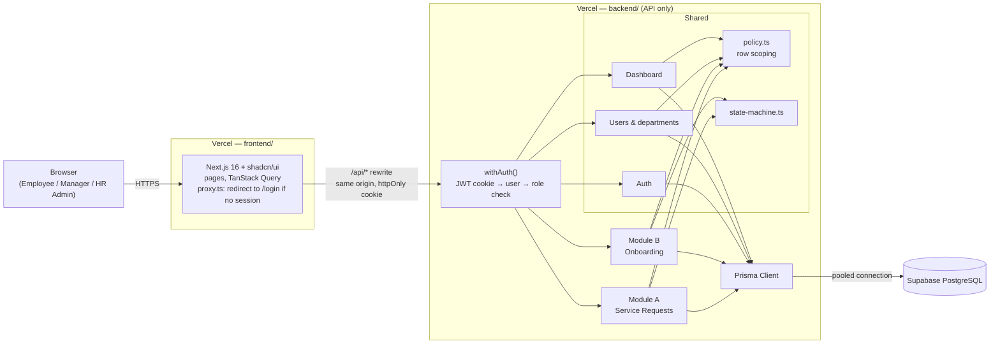
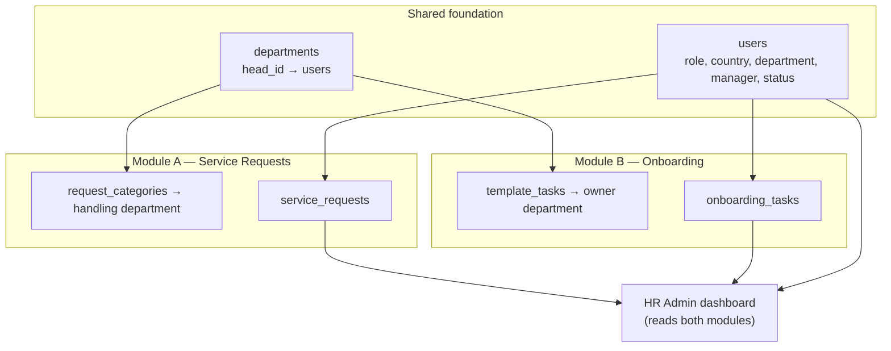
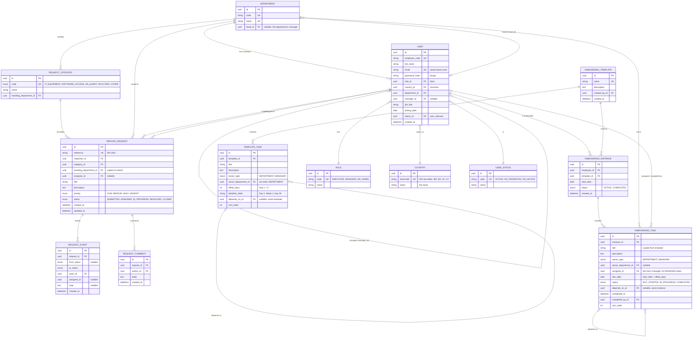
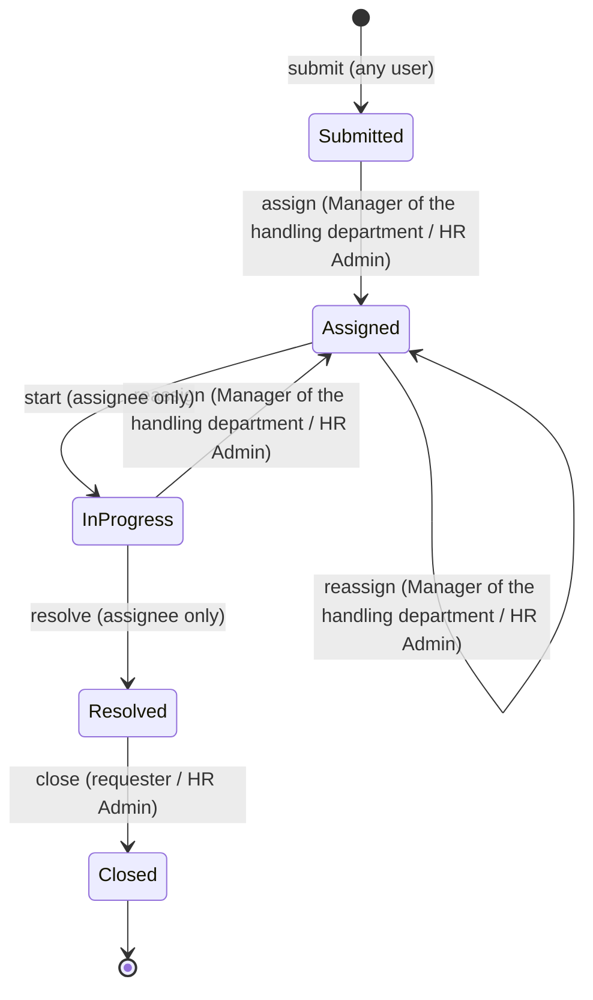
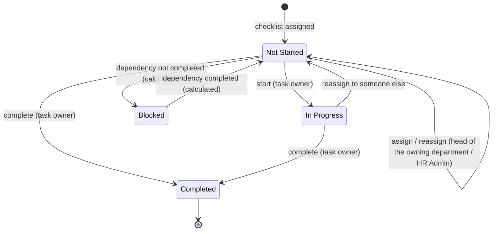

# Architecture v1 — HRIS Service Request & Onboarding Platform

> **Scope of this document:** the **base web application** that will be built and deployed in this
> submission: a Next.js frontend, a Next.js API backend and a Supabase PostgreSQL database.
> Everything described here is built. Features intentionally left out are listed in
> [§9 Not in v1](#9-not-in-v1).

Internal platform for a ~100-person company in **Bangladesh, Malaysia, Sri Lanka and Cyprus**. It
combines **Service Requests** and **Employee Onboarding** on one shared foundation of users,
departments, roles, authentication and an HR Admin dashboard.

---

## Contents

1. [Architecture](#1-architecture)
2. [System Design Justification](#2-system-design-justification)
3. [Data Model](#3-data-model)
4. [API Design](#4-api-design)
5. [Access Control](#5-access-control)
6. [State Machines](#6-state-machines)
7. [Seed Data](#7-seed-data)
8. [Trade-Offs](#8-trade-offs)
9. [Not in v1](#9-not-in-v1)
10. [Repository, Deployment & Environment](#10-repository-deployment--environment)

---

## 1. Architecture

### 1.1 Components

| Component | Folder | Technology | Hosting | Responsibility |
|---|---|---|---|---|
| **Frontend** | `frontend/` | Next.js 16 (App Router), TypeScript, shadcn/ui, Tailwind CSS, TanStack Query, ApexCharts (`react-apexcharts`) | Vercel (project 1) | UI only. No database access, no secrets. Calls the backend through a same-origin `/api/*` rewrite. |
| **Backend** | `backend/` | Next.js 16 **API-only** (Route Handlers), TypeScript, Prisma, zod, `jose` (JWT), bcrypt | Vercel (project 2) | Auth, access control, all reads and writes, state transitions, dashboard aggregates, schema, migrations and seed script. |
| **Database** | — | PostgreSQL on Supabase (via the Supabase connection pooler) | Supabase | Single source of data. Used as plain PostgreSQL. |

Each service has its own `package.json`, lockfile, `.env.example` and Vercel project. No code is
shared between them; the contract is the HTTP API in §4.

### 1.2 System diagram



### 1.3 How the two modules share the foundation



**Both modules decide "who is responsible?" through `departments`.** A request category routes to a
handling department; an onboarding task is owned by a department (or by the new hire's manager).
The same rule decides who works both: the **head of the department** sees everything routed to it and
either handles it or **assigns it to one member** (§5.3, §6.2). The same `users.manager_id` reporting line decides what a Manager can see in
both modules. No user, team or department data is duplicated.

### 1.4 How a request flows

1. The browser calls `/api/v1/...` on the frontend's domain; the frontend's rewrite forwards it to
   the backend. The browser sees one origin, so the session cookie works without CORS setup.
2. `withAuth()` (built on `withRequest()`, which also wraps the public routes) gives the request an id, verifies the
   JWT, loads the user from the database (so role changes apply immediately), checks the endpoint's allowed roles
   and, when the response is ready, writes one log line (§4.8).
3. The handler queries through `policy.ts`, which adds the user's row scope. Rows outside the scope
   return `404`.
4. Status changes go through `state-machine.ts`, which checks the current state and the actor, then
   saves the new state and a history row in one transaction.
5. Responses include `allowedActions`, so the frontend shows only the buttons the user may press.

---

## 2. System Design Justification

### 2.1 Separate frontend and backend, ready for a separate AI service

The frontend and backend are separate deployments that talk only through the versioned HTTP API
(`/api/v1`). This keeps the system loosely coupled: the UI can change without touching business
logic, and the API can be tested and documented on its own. The backend is the only component that
holds secrets or touches the database.

The platform's AI capability is designed as a **separate service** that connects to this backend
through its API (and, for long-running work, a message broker or job queue). It is not part of this
v1 document; v1 keeps the API boundary clean so it can be added without restructuring.

### 2.2 Supabase (managed PostgreSQL) instead of an in-memory or embedded database

- **Data must outlive the application.** Vercel functions are short-lived and can be replaced at
  any time, so an in-memory or file-based database (such as SQLite on the server's disk) would lose
  data. A managed database is run and backed up separately from the application.
- **PostgreSQL** is a mature, widely used relational database with everything this design needs:
  foreign keys, `CHECK` constraints, native enums, partial indexes and strong SQL for dashboard
  aggregates.
- **Supabase** runs PostgreSQL as a managed service, with a connection pooler suited to serverless
  functions, a SQL editor for inspecting data, and backups. It also supports the `pgvector` extension,
  so a future retrieval-based (RAG) feature could store embeddings in the same database.

---

## 3. Data Model

### 3.1 Why PostgreSQL + Prisma

The data is relational and rule-heavy: reporting lines, task dependencies, routing by department and
fixed sets of states. The database enforces these with foreign keys, enums and `CHECK` constraints,
so invalid data is rejected even if application code has a bug. Prisma provides a readable schema
file, versioned migrations, generated TypeScript types, transactions and a seed workflow. Rules
Prisma's schema cannot express (`CHECK` constraints, partial indexes) are added in a hand-written SQL
migration.

### 3.2 Entity-relationship diagram



### 3.3 Tables and rules

**Shared**

| Table | Rules |
|---|---|
| `departments` | 7 departments: Engineering, People & Culture, Finance, Marketing, IT Operations, Legal & Compliance, Operations. `head_id` is the Manager who runs the department; it decides who triages requests routed there. |
| `users` | Unique email, stored lower-case. `manager_id` points to another user (`CHECK (manager_id <> id)`). Never hard-deleted. A user is a **new hire** when they have an `ACTIVE` onboarding instance; this is not a separate column. |
| Roles, countries, statuses | Three lookup tables (`roles`, `countries`, `user_statuses`) that `users` points to with required foreign keys (`ON DELETE RESTRICT`). Each row has a generated id; roles and statuses also have a `code` and `name`, countries a two-letter `shortcode` (checked by `CHECK ~ '^[A-Z]{2}$'`) and a full `name`. Rows are added by migration or seed only: the API cannot create, edit or delete them, and row-level security is on with no policies. Code never relies on a generated id: behaviour compares `role.code`, `status.code` and `country.shortcode`. What each role may do is defined in code in `policy.ts` (§5). One role per user. |
| Sessions | Signed JWT (8 hours) in an httpOnly, `Secure`, `SameSite=Lax` cookie containing only the user ID. The role is read from the database on every request, so a role change applies at once. No session table. |

**Module A — Service Requests**

| Table | Rules |
|---|---|
| `request_categories` | IT Equipment and Software Access → IT Operations; HR Query and Other → People & Culture; Facilities → Operations. |
| `service_requests` | `handling_department_id` is copied from the category at submit time. `reference` comes from a sequence (`SR-1001`, …). `CHECK (status = 'SUBMITTED' OR assignee_id IS NOT NULL)`. Country filtering uses the requester's country (no duplicate column). |
| `request_events` | One row per status change or assignment, written in the same transaction. Drives the timeline on the request page. |
| `request_comments` | Author and timestamp are set by the server. |

**Module B — Onboarding**

| Table | Rules |
|---|---|
| `onboarding_templates` | Reusable checklist, created by HR Admin. |
| `template_tasks` | `CHECK ((owner_type = 'DEPARTMENT') = (owner_department_id IS NOT NULL))`. A dependency must point to a task in the same template, with no cycles; checked when the template is saved. Deadline labels map to offsets: Day 1 = 0, Week 1 = 4, Day 30 = 29. |
| `onboarding_instances` | Partial unique index: one `ACTIVE` instance per employee. Becomes `COMPLETED` automatically when its last task is completed. |
| `onboarding_tasks` | A **copy** of the template's tasks made at assignment, with `due_date = start_date + offset_days`. For `MANAGER` tasks, `assignee_id` is set to the new hire's manager. For `DEPARTMENT` tasks, `assignee_id` starts empty: the head of the owning department assigns it to one of its members (§6.2). Dependencies point to the copied task in the same instance. |

**Stored vs calculated status.** Only `NOT_STARTED`, `IN_PROGRESS` and `COMPLETED` are stored.
**Blocked** and **Overdue** are calculated whenever tasks are read:

```text
blocked = status <> COMPLETED and the task it depends on is not COMPLETED
overdue = status <> COMPLETED and due_date < today (Asia/Dhaka date)
shown as: Completed → Blocked → In Progress / Not Started, with an Overdue flag shown separately
```

They can never be out of date, and no scheduled job is needed (§8.2).

### 3.4 Indexes

PostgreSQL does not index foreign keys automatically, and an index on a column with only a few values
(such as `status` alone) is rarely used. Indexes are therefore chosen to match the queries the app
runs. Partial indexes cover only unfinished work, so they stay small as closed items accumulate.

| Table | Index | Used by |
|---|---|---|
| `users` | unique `(email)` | Login |
| | `(manager_id)` | Manager's team in both modules |
| | `(department_id, status_id)` | Assignee picker; department membership |
| | `(country_id)` | Headcount by country |
| `service_requests` | unique `(reference)` | Lookup by reference |
| | `(requester_id, created_at DESC)` | "My requests" |
| | `(assignee_id, status)` | "Assigned to me" |
| | `(handling_department_id, created_at DESC) WHERE status NOT IN ('RESOLVED','CLOSED')` | Department queue *(partial, SQL migration)* |
| | `(status, created_at DESC)` | HR Admin list filtered by status |
| | `(category_id, status)` | Category filter; dashboard |
| `request_events` | `(request_id, created_at)` | Request timeline |
| `request_comments` | `(request_id, created_at)` | Comment thread |
| `template_tasks` | `(template_id, sort_order)` | Template view; checklist assignment |
| `onboarding_instances` | unique `(employee_id) WHERE status = 'ACTIVE'` | One active onboarding per person *(partial, SQL migration)* |
| `onboarding_tasks` | `(instance_id, sort_order)` | Checklist and progress per hire |
| | `(owner_department_id, due_date) WHERE status <> 'COMPLETED'` | Department task queue *(partial, SQL migration)* |
| | `(assignee_id, due_date) WHERE status <> 'COMPLETED'` | Manager's task queue *(partial, SQL migration)* |
| | `(depends_on_id)` | Blocked calculation |

Partial indexes are written in a SQL migration because Prisma's schema cannot express them. Every
generated Prisma migration is reviewed before it is applied, so Prisma does not drop these indexes.

### 3.5 Supabase setup

- Supabase is used **only as PostgreSQL**. Supabase Auth and its auto-generated Data API are not used.
- **Row-level security is enabled on every table with no policies.** This blocks Supabase's public
  Data API from reading the tables, while the backend's database connection is unaffected. The
  Supabase anon and service keys are not used anywhere.
- The backend connects through the Supabase pooler in transaction mode (`pgbouncer=true`,
  `connection_limit=1`) at runtime, and through a direct connection for migrations.

### 3.6 How the two modules share data without duplication

- One `users` table serves as requester, assignee, commenter, new hire, task assignee and completer.
- One `departments` table is both the request's handling team and the onboarding task's owner.
- One reporting line (`manager_id`) decides Manager visibility in both modules.
- The dashboard's cross-module insights are joins across both modules, not copies.
- The only intentional copies are for history: a request's handling department, and the task fields
  copied from a template, so later changes don't alter existing records.

---

## 4. API Design

### 4.1 Conventions

- **Base path:** `/api/v1`. The major version is in the URL; a breaking change would be released as
  `/api/v2` alongside `v1`. Route handlers live in `backend/app/api/v1/`.
- **Auth:** httpOnly cookie `hris_session`. Every endpoint requires login except `POST /auth/login`
  and `GET /health`.
- **Format:** JSON; request bodies validated with zod; dates as `YYYY-MM-DD`.
- **Lists:** `?page=1&pageSize=20` → `{ data, page, pageSize, total }`.
- **Errors:** `{ "error": { "code": "INVALID_TRANSITION", "message": "...", "requestId": "..." } }`
- **Request id:** every response, including errors, carries an `x-request-id` header (also `error.requestId` in an error
  body). A caller may send its own `x-request-id`; it is kept only if it is a UUID. Quote the id when reporting a problem (§4.8).

| Status | Meaning |
|---|---|
| `401` | Not logged in |
| `403` | Role not allowed for this endpoint |
| `404` | Not found, or outside the user's scope |
| `409` | Invalid status change (e.g. starting a blocked task) |
| `422` | Validation failed |

Roles: **E** Employee, **M** Manager, **H** HR Admin, **Any** = logged-in user. "Scoped" = filtered by §5.2.
All paths below are relative to `/api/v1`.

### 4.2 Auth

| Method | Path | Auth | Request | Response |
|---|---|---|---|---|
| POST | `/auth/login` | Public | `{ email, password }` | `{ user }` + session cookie; `401` on bad credentials |
| POST | `/auth/logout` | Any | — | `204`, clears cookie |
| GET | `/auth/me` | Any | — | `{ user, isNewHire, headOfDepartmentId }` |

`user = { id, employeeCode, fullName, email, role, country, department, managerId, jobTitle, status, joiningDate }`, where `role` and `status` are `{ id, code, name }`, `country` is `{ id, shortcode, name }` and `department` is `{ id, code, name }`. The frontend shows `name` and compares `code` / `shortcode`.

### 4.3 Users and reference data

| Method | Path | Auth | Request | Response |
|---|---|---|---|---|
| GET | `/users` | M (direct reports), H (all) | `?search&countryId&departmentId&statusId&roleId&page` | paginated users |
| POST | `/users` | H | `{ fullName, email, countryId, departmentId, managerId, jobTitle, joiningDate, roleId?, statusId?, templateId? }` | `201` user; if `templateId` is given, the onboarding checklist is created in the same transaction. `roleId` defaults to Employee; a Manager becomes the department's head if it has none, and a second Manager in a department is `422` (path `roleId`). `statusId` defaults to On probation and cannot be On notice |
| GET | `/users/assignable` | M, H | `?departmentId` | active members of that department |
| GET | `/meta` | Any | — | departments, request categories, `roles`, `countries` and `userStatuses` (each with ids, for filters and forms) and the remaining enum values for form dropdowns |
| GET | `/health` | Public | — | `{ status: "ok" }` |

### 4.4 Service requests (Module A)

| Method | Path | Auth | Request | Response |
|---|---|---|---|---|
| GET | `/requests` | Any (scoped) | `?status&categoryId&priority&countryId&channel&mine&page` | paginated requests; `mine=true` keeps only requests the caller raised themselves, `channel` filters by how they were raised |
| POST | `/requests` | Any | `{ categoryId, title, description, priority, handlingDepartmentId?, channel? }` | `201` request, status `SUBMITTED`. The request goes to the category's department unless `handlingDepartmentId` names another (`422` if it does not exist); that department's Manager sees it. `channel` (`FORM` default, or `CHAT` when raised through the chat assistant) only labels the request |
| GET | `/requests/:id` | Scoped | — | request + `events` + `comments` + `allowedActions` |
| POST | `/requests/:id/transitions` | Per §6.1 | `{ action: "assign" \| "start" \| "resolve" \| "close", assigneeId?, note? }` | updated request; `409` if not allowed |
| POST | `/requests/:id/comments` | Scoped | `{ body }` | `201` comment |

### 4.5 Onboarding (Module B)

| Method | Path | Auth | Request | Response |
|---|---|---|---|---|
| GET | `/onboarding/templates` | H | — | templates with task counts |
| POST | `/onboarding/templates` | H | `{ name, description, tasks: [{ key, title, description, ownerType, ownerDepartmentId?, offsetDays, deadlineLabel, dependsOnKey? }] }` | `201` template; `422` on dependency cycle |
| GET | `/onboarding/templates/:id` | H | — | template with ordered tasks |
| PUT | `/onboarding/templates/:id` | H | same body as create | updated template; replaces name, description and tasks. Checklists already assigned are copies and are **not** changed; `422` on dependency cycle, `409` on duplicate name |
| POST | `/onboarding/instances` | H | `{ employeeId, templateId, startDate? }` | `201` checklist with dated tasks; `409` if one is already active |
| GET | `/onboarding/instances` | M (direct reports, and checklists with a task owned by the department they head), H (all) | `?countryId` | per hire: `{ total, completed, inProgress, notStarted, blocked, overdue, percentComplete }` |
| GET | `/onboarding/instances/:id` | Hire (own), M (direct report, or a checklist with a task owned by the department they head), H | — | checklist with all tasks and calculated status |
| GET | `/onboarding/me` | Any | — | own checklist, or `null` |
| GET | `/onboarding/tasks` | Any (tasks the user owns) | `?status&overdue&assigned` | task queue across all new hires: tasks assigned to the user, plus, for a department head, every task the department owns. `assigned=false` lists tasks nobody has yet. H sees all (read only) |
| POST | `/onboarding/tasks/:id/transitions` | Task owner | `{ action: "start" \| "complete" }` | updated task; `409` if blocked |
| POST | `/onboarding/tasks/:id/assign` | Head of the owning department, H | `{ assigneeId }` | updated task. The assignee must be an active member of the owning department (`422`, path `assigneeId`); `409` on a completed task, a `MANAGER` task, or someone without the right; assigning the person who already has it is `422`. Reassigning an In Progress task sends it back to Not Started |

### 4.6 Dashboard

| Method | Path | Auth | Response |
|---|---|---|---|
| GET | `/dashboard/summary` | H | `{ headcountByCountry, requestsByStatus, requestsByCategory, onboarding: { activeHires, overdueTasks, blockedTasks }, newHiresWaiting, completionRateByCountry }` |

The last two fields are the cross-module insights. `newHiresWaiting` has one entry per department that handles
requests (a department with at least one request category: IT Operations, Operations, People & Culture), IT Operations
first, then by name: `{ department: { id, code, name }, count, hires: [{ id, fullName, country, department, instanceId,
openRequests }] }`. A hire is listed under every department they have an open request with, and `openRequests` holds only
that department's requests. The dashboard card "New hires waiting on <department>" has a selector for these departments
and starts on IT Operations.

### 4.7 Department breakdown *(added after v1 sign-off)*

An HR Admin view of how the workforce is spread across departments.

| Method | Path | Auth | Response |
|---|---|---|---|
| GET | `/departments/breakdown` | H | `{ total, departments: [{ id, code, name, head: { id, fullName } \| null, headcount, byCountry: [{ country, count }], byStatus: [{ status, count }], byRole: [{ role, count }] }] }` |

- Counts every person in the department, whatever their status (same basis as the dashboard headcount).
  `total` is the sum of the department headcounts and equals the dashboard's total headcount.
- Departments are sorted by headcount (largest first), then name. A department with nobody still appears, with zeros.
- Every `byCountry`, `byStatus` and `byRole` list carries all values (zero included) in a fixed order, so the UI
  needs no gap-filling.
- Page: **Departments** (`/departments`, HR Admin only, in the sidebar). One row per department with the head,
  headcount and its share of the company, and the split by country, status and role. Selecting a department opens
  **People** filtered to it (`/people?departmentId=…`). Managers and Employees get `403` from the API and no nav item.

---

### 4.8 System logs *(added after v1 sign-off)*

The backend writes structured logs so that a failed request can be traced: when it happened, on which route, for which
user, and why. Spec: `docs/spec-system-logs.md`. Logs go to stdout and stderr only; nothing is stored in the database
or in a file.

**Format.** One JSON object per line. `debug` and `info` go to stdout; `warn` and `error` go to stderr, so a host can flag
errors. While developing (`NODE_ENV=development`) a short coloured line is printed instead (errors red, warnings yellow);
production and tests always print JSON. `LOG_LEVEL` (`debug`, `info`, `warn`, `error`; default `info`) sets the lowest level written.

**Lines written** (every line has `ts`, `level`, `event`):

| Event | Level | When | Main fields |
|---|---|---|---|
| `http.request` | info (2xx, 3xx), warn (4xx), error (5xx) | Every request, except `GET /health` | `requestId, method, route, status, ms, userId` |
| `http.error` | error | An unexpected error (the 500s); the response body stays generic | `requestId, method, route, userId, errorName, errorCode, message, stack` (message and stack redacted) |
| `auth.login` | info | Successful sign-in | `requestId, route, userId, ip, userAgent` |
| `auth.login_failed` | warn | Wrong password or unknown email (the same event for both) | `requestId, route, ip, userAgent` |
| `auth.logout` | info | Sign-out | `requestId, route, userId, ip, userAgent` |
| `auth.session_invalid` | warn | A 401 on a request that sent a cookie (expired, forged, or its user is gone) | `requestId, route, ip, userAgent` |
| `auth.forbidden` | warn | A 403 | `requestId, route, userId, ip, userAgent` |
| `chat_drafts.write_failed` | error | The developer record of an AI draft could not be saved (the draft is still returned) | `requestId, errorName, errorCode` |

`route` is the route pattern (`/api/v1/requests/:id/comments`), never the real URL, so ids and query strings stay out.
`ip` is the first forwarded address (cut to 64 characters) and `userAgent` is cut to 300; both are left out when not sent.

**Never logged:** request or response bodies, headers, cookies, the session token, passwords or hashes, the attempted
email on a failed login, API keys, or the text of an AI chat message. Text taken from an error passes through `redact`
first, which removes JWTs, bearer values, bcrypt hashes, API-key shapes, `key=`/`token=`/`password=` values and email
addresses, and cuts it to a length limit. A logging problem never changes a response.

**Finding a request by its id.** The id is in the `x-request-id` response header (browser developer tools, Network tab)
and in the `error.requestId` of an error body. Search for it in the backend's output, for example
`npm run dev 2>&1 | grep <id>` locally or the log search on the host. For an AI draft the same id is also the
`chat_drafts.request_id` column and the id in the AI service's own log lines, so one id finds all three.

**Retention.** Logs last as long as the host keeps them (short on Vercel). This is accepted for now; a log drain to an
outside service can read the same JSON later without code changes. An audit trail of who changed which HR data is not part
of this and has not been built.

---

## 5. Access Control

### 5.1 Roles

| Role | Summary |
|---|---|
| **Employee** | Submits requests; sees own requests and requests assigned to them; sees own onboarding checklist; works the onboarding tasks assigned to them. |
| **Manager** | Everything an Employee can do, plus: sees requests from direct reports; as head of their own department (the Manager role is the department head; there is no separate head with extra permissions), sees and assigns requests routed to that department; monitors onboarding of direct reports and of any checklist that has a task owned by the department they head (opening it grants no actions); works `MANAGER` tasks for their new hires; as department head, sees every onboarding task the department owns and either does it or assigns it to a member. |
| **HR Admin** | Sees everything in both modules; creates templates and new hires; assigns checklists; can assign any department's onboarding tasks; uses the dashboard. |

Requests and department onboarding tasks reach a person the same way: the **head of the department** assigns them
to an active member (department membership decides who can be chosen), so an Employee in IT Operations works the IT
requests and IT onboarding tasks the IT head gave them.

### 5.2 Permission matrix

| Capability | Employee | Manager | HR Admin |
|---|---|---|---|
| Submit request | ✅ | ✅ | ✅ |
| View requests | Own + assigned to me | + direct reports' + own department's queue | All, filterable by country |
| Assign request | ❌ | Requests routed to their own department | ✅ |
| Start / resolve request | If assignee | If assignee | If assignee |
| Close request | If requester | If requester | ✅ |
| Comment | On any request they can view | On any request they can view | ✅ |
| View own checklist | ✅ | ✅ | ✅ |
| Onboarding task queue | Tasks assigned to me | + all tasks of the department they head, assigned or not, + `MANAGER` tasks for direct reports | All (read only) |
| Assign onboarding task | ❌ | Tasks owned by the department they head | ✅ (any department task) |
| Start / complete task | If assigned to them | If assigned, or the task is their department's, + own `MANAGER` tasks | Only tasks assigned to them; no override |
| Onboarding progress | ❌ | Direct reports + checklists with a task owned by the department they head | All |
| Templates, new hires, assign checklist | ❌ | ❌ | ✅ |
| Dashboard | ❌ | ❌ | ✅ |

### 5.3 How it is enforced

1. **`withAuth(handler, { roles })`** wraps every route. It verifies the JWT, loads the user from the
   database and rejects disallowed roles with `403`.
2. **`policy.ts` row scoping.** Functions return Prisma `where` clauses that every query uses, for
   example:

   ```ts
   export function scopeRequests(user: AuthUser): Prisma.ServiceRequestWhereInput {
     if (user.role === "HR_ADMIN") return {};
     const scope: Prisma.ServiceRequestWhereInput[] = [
       { requesterId: user.id },
       { assigneeId: user.id },
     ];
     if (user.role === "MANAGER") {
       scope.push({ requester: { managerId: user.id } });
       if (user.headOfDepartmentId) scope.push({ handlingDepartmentId: user.headOfDepartmentId });
     }
     return { OR: scope };
   }
   ```

   Detail endpoints look rows up together with the scope, so out-of-scope rows return `404`.
3. **`state-machine.ts`** holds the transition tables from §6 and checks state and actor before any
   change (`409` otherwise). The same tables produce `allowedActions` for the UI.
4. **Database constraints** (foreign keys, enums, `CHECK`s, partial unique indexes) reject invalid data.

The frontend hides menu items and buttons by role, but that is only for display; the backend makes
every real decision. The frontend's `proxy.ts` only redirects users without a session to `/login`.

**Tests:** unit tests (Vitest) for `state-machine.ts` and `policy.ts`, covering each transition by
allowed and disallowed roles and each role's request scope.

---

## 6. State Machines

### 6.1 Service request



| From | Action | To | Who | Notes |
|---|---|---|---|---|
| — | `submit` | Submitted | Any user | Routed to the category's handling department |
| Submitted / Assigned / In Progress | `assign` | Assigned | Manager of the handling department; HR Admin | Assignee must be an active member of the handling department. Reassigning a request that is **In Progress** sends it back to Assigned, so the new assignee starts it; it must go to someone other than the current assignee (`422`) |
| Assigned | `start` | In Progress | Assignee only | |
| In Progress | `resolve` | Resolved | Assignee only | Optional note |
| Resolved | `close` | Closed | Requester; HR Admin | Final state |

Every other combination returns `409`. Each change writes a `request_events` row.

### 6.2 Onboarding task



| From | Action | To | Who | Rule |
|---|---|---|---|---|
| Not Started | `start` | In Progress | Task owner | Not allowed while blocked (`409`) |
| Not Started / In Progress | `complete` | Completed | Task owner | Not allowed while blocked (`409`) |
| Not Started / In Progress | `assign` | Not Started | Head of the owning department; HR Admin | `DEPARTMENT` tasks only. Assignee must be an active member of the owning department. A blocked task can be assigned ahead of time. Reassigning an In Progress task to someone else sends it back to Not Started, so the new person starts it |
| Blocked | — | — | — | No actions; the UI shows which task it is waiting for |

**How a department task reaches a person.** When a checklist is assigned, each department task is owned by a
department and has **nobody assigned yet**. The **head of that department** sees all of the department's tasks and
either completes them directly or assigns each to one active member of the department. The assignee then sees the task
in their queue; other members of the department do not see it.

**Task owner** (who may start / complete) = the person it is assigned to, or the head of the owning department; for a
`MANAGER` task, the assigned manager. HR Admin has no override: they can see every task and assign department tasks (which
also covers a department that has no head), but start or complete only the tasks assigned to them. This matches service
requests, where the head assigns and only the assignee acts.

**Why the head assigns (and not a "designated contact" per department).** It is the rule the product already uses for
service requests, so there is one way to route work to a person; it needs no new table or setting, because
`departments.head_id` already names the head (every department has exactly one); and a per-department contact would be a
setting someone must keep current when people leave or change role. The cost is that the head becomes a step in the
path, which is acceptable at this size, and the head can always do a task directly without assigning it.

Each task has at most one dependency, and chains (A → B → C) are allowed. The blocked check is
repeated inside the transaction. When the last task is completed, the instance becomes `COMPLETED`.

---

## 7. Seed Data

`backend/prisma/seed.ts` (`npm run db:seed`) clears and recreates all data. Dates are relative to the
day the seed runs, so overdue and in-progress scenarios stay realistic.

| Data | Contents |
|---|---|
| Departments | 7, each with a head |
| Employees | 100: Bangladesh 40, Malaysia 25, Sri Lanka 20, Cyprus 15. Names from country-appropriate lists, realistic job titles. 3 HR Admins, 7 Managers (exactly one per department, who heads it), the rest Employees. Mostly Active, ~10 On Probation (incl. all new hires), ~4 On Notice. |
| Service requests | 35 across all 5 categories, 5 statuses and 4 priorities, with realistic titles and descriptions. History rows match each request's status. At least 6 requests with 2–4 comments. Several from new hires. |
| Templates | "Standard Onboarding" (10 tasks) and "Engineering Onboarding" (12 tasks), with dependency chains such as *Create accounts → Provision laptop → Grant repository access*. |
| New hires | 7, joined 10–55 days ago across all four countries, with Completed, In Progress and Not Started tasks, at least 3 overdue and at least 2 blocked. |
| Logins | At least one per role, listed in `README.md`: an HR Admin; a Manager whose direct reports include a new hire; a new-hire Employee; an IT Operations Employee with assigned requests and IT onboarding tasks. |
| Task assignment | Department tasks that were started or finished are assigned to a member of the owning department (the IT login holds most of IT's); about half of the not-started ones are still unassigned, so the department head has something to assign. |

---

## 8. Trade-Offs

### 8.1 Separate frontend and backend vs a single Next.js app

- **Considered:** one Next.js app containing both pages and API routes.
- **Chose:** two Next.js apps deployed separately. The API is a clear contract that can be tested on
  its own, the frontend has no database access or secrets, and other clients (such as the planned AI
  service) can use the same API.
- **Cost:** two Vercel projects, a rewrite between them, and no shared TypeScript types, so request
  and response types are written on both sides.
- **With more time:** generate an OpenAPI spec from the backend's zod schemas and generate frontend
  types from it.

### 8.2 Calculated vs stored Blocked and Overdue

- **Considered:** storing `BLOCKED` and `OVERDUE` as statuses, updated by triggers or a nightly job.
- **Chose:** calculating them on read. Overdue depends on today's date and Blocked depends on another
  task; storing them adds a second source of truth that can go stale. At this scale the calculation
  is cheap.
- **Cost:** slightly more complex queries; filtering by "blocked" needs a join.
- **With more time:** overdue notifications through a scheduled job, while keeping the status
  calculated.

### 8.3 Access control in the backend vs PostgreSQL row-level security

- **Considered:** writing access rules as PostgreSQL RLS policies.
- **Chose:** `withAuth` + `policy.ts` + `state-machine.ts` in the backend. The rules depend on
  department heads, reporting lines and workflow state, and are easier to read and test as
  TypeScript functions. Setting a per-request user for RLS through a pooled connection is error-prone.
- **With more time:** add RLS policies as a second layer of protection.

### 8.4 Copying template tasks vs referencing the template

- **Chose:** copying tasks when a checklist is assigned, so later template changes don't alter
  onboardings that are already under way.
- **Cost:** a fix to a template does not reach checklists that were already assigned.

---

## 9. Not in v1

Deliberately left out to fit the timeline. None of these appear in the code.

- **AI service:** documented separately; this v1 keeps the API ready for it.
- Request **reopen**, **withdraw** or **reject**, and HR override of resolve.
- **Archiving or deleting** templates, reopening completed tasks, cancelling onboardings. (Editing a template *is* in v1: it only affects checklists assigned afterwards.)
- Editing users after creation, deactivation and session revocation.
- OpenAPI spec and generated frontend types.
- Rate limiting, an audit log beyond request history, notifications (email or Slack).
- Business-day deadlines and public-holiday calendars per country.
- End-to-end and API integration tests (v1 has unit tests for the state machine and access policy).

### Assumptions

1. A Manager's **team** is their direct reports. The **Manager of the handling department** (a Manager is
   the head of their own department) triages and assigns requests routed there.
2. There is no separate approval state; "approve and assign" is the assign step.
3. Each onboarding task has at most one dependency. A department task is assigned to one person by the department head; there is no shared "anyone in the department" ownership.
4. Overdue is calculated against today's date in Asia/Dhaka.
5. Accounts are created by the seed script or by HR Admin; there is no self-registration.

---

## 10. Repository, Deployment & Environment

```
hris-platform/
├── frontend/                  # Next.js 16 + shadcn/ui → Vercel
│   ├── app/                   # (auth)/login, (app)/dashboard, requests, onboarding, people
│   ├── components/ui/         # shadcn components
│   ├── components/            # requests/, onboarding/, dashboard/
│   ├── lib/                   # api client, types, TanStack Query hooks
│   ├── proxy.ts               # redirect to /login without a session
│   └── next.config.ts         # rewrite /api/:path* → backend
├── backend/                   # Next.js 16 API only → Vercel
│   ├── app/api/v1/            # route handlers by domain
│   ├── src/services/          # policy.ts, state-machine.ts, onboarding.ts, dashboard.ts
│   ├── src/lib/               # auth, prisma client, errors, validation
│   ├── prisma/                # schema.prisma, migrations/, seed.ts
│   └── tests/
├── architecture-v1.md
├── DEBUG_LOG.md
└── README.md
```

| Service | Variable | Purpose |
|---|---|---|
| frontend | `BACKEND_URL` | Backend URL for the `/api` rewrite |
| backend | `DATABASE_URL` | Supabase pooler connection (transaction mode) |
| backend | `DIRECT_URL` | Supabase direct connection for migrations |
| backend | `JWT_SECRET` | Session signing key |
| backend | `LOG_LEVEL` | Optional. Lowest log level written: `debug`, `info` (default), `warn`, `error` |

No secrets are committed; each service has an `.env.example`.
